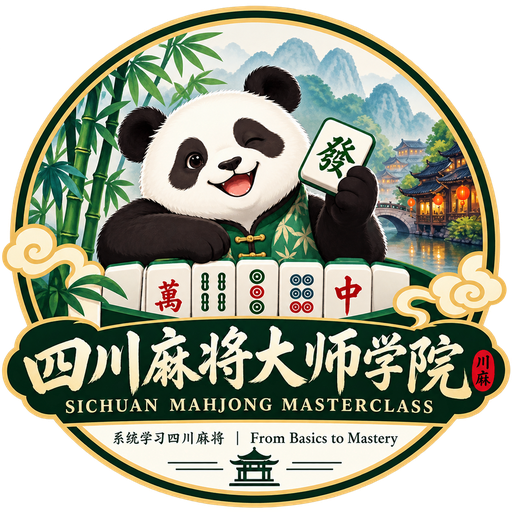

<div align="center">



# 四川麻将大师学院

**从零开始，系统学习四川麻将（川麻）：规则、牌效、番型、概率、攻守、残局与复盘。**

[](https://github.com/jyu-zhou/sichuan-mahjong-masterclass/releases/latest)
[](https://jyu-zhou.github.io/sichuan-mahjong-masterclass/)
[](LICENSE-CODE)
[](LICENSE-CONTENT)
[](#课程导读)

[English](README.en.md) · [在线课程](https://jyu-zhou.github.io/sichuan-mahjong-masterclass/) · [离线单文件](https://github.com/jyu-zhou/sichuan-mahjong-masterclass/releases/latest) · [完整教材](docs/zh-CN/textbook.md)

</div>

四川麻将大师学院是一套**从小白到能独立分析牌局**的双语教程。它不是“牌桌口诀合集”，而是把一手牌拆成可以检查的步骤：先确认规则和合法性，再比较牌效；先区分确定信息与隐藏信息，再用概率模型；最后才讨论风险与长期期望收益。

课程默认采用本项目已经锁定的四川麻将主线：四人、108 张万/筒/条、换三张、定缺、不吃、可碰杠、血战到底。房间参数存在差异的地方会明确写出边界，不把不同平台的规则偷偷混在一起。

> **先合法，再牌效；先事实，再推断；先写清假设，再谈期望值。**

## 导读

<table>
<tr><td align="right"><b>直接学习</b></td><td><a href="https://jyu-zhou.github.io/sichuan-mahjong-masterclass/">中文在线课程</a> · <a href="https://jyu-zhou.github.io/sichuan-mahjong-masterclass/en/">English</a></td></tr>
<tr><td align="right"><b>离线携带</b></td><td><a href="https://github.com/jyu-zhou/sichuan-mahjong-masterclass/releases/latest">Release 下载</a> · <a href="standalone.html">仓库内单文件 HTML</a></td></tr>
<tr><td align="right"><b>查教材</b></td><td><a href="docs/zh-CN/textbook.md">中文 Markdown 教材</a> · <a href="textbook.html">浏览器教材</a> · <a href="docs/en/textbook.md">English textbook</a></td></tr>
<tr><td align="right"><b>让 AI 教</b></td><td><a href="#让-aiagent-按本项目教学">复制 Quick Start Prompt</a> · <a href="AGENT_GUIDE.md">完整 Agent Guide</a></td></tr>
<tr><td align="right"><b>动手练</b></td><td>摆牌实验室 · 番型图鉴 · 概率/收益计算器 · 45 道互动题 · 连续读牌时间轴</td></tr>
<tr><td align="right"><b>参与项目</b></td><td><a href="CONTRIBUTING.md">贡献指南</a> · <a href="https://github.com/jyu-zhou/sichuan-mahjong-masterclass/issues">Issues</a> · <a href="https://github.com/jyu-zhou/sichuan-mahjong-masterclass/releases">Releases</a></td></tr>
</table>

## 这套课解决什么问题

| 你遇到的问题 | 去哪里学 |
| --- | --- |
| 完全不会麻将，牌都认不全 | 第 1–7 课：规则契约、108 张牌、胡牌骨架、摸打碰杠与整局流程 |
| 开局该换哪三张、到底缺哪门 | 第 8–10 课：换三张与定缺 |
| 两张牌看起来都能打，怎么比较 | 第 11–15 课：搭子、有效张、向听、改良与摸后决策 |
| “番”和“倍”到底是什么，碰杠值不值 | 第 16–21 课：番型、根、杠账、呼叫转移与机会成本 |
| “还有几张能摸到”怎样严谨计算 | 第 22–23 课：实体张数、超几何分布与不放回抽样 |
| 怎么读对手，而不是靠“感觉他像听了” | 第 24–27 课：条件概率、贝叶斯、逐家风险与动态读牌 |
| 牌墙快没了，还应该冲吗 | 第 28–32 课：查花猪、查大叫、退税、残局与完整局势推演 |
| 打完一局怎么知道自己哪里真错了 | 第 33–34 课：大师十二问、反事实复盘与概率校准 |

## 课程导读

| 阶段 | 课次 | 学完应该会什么 |
| --- | ---: | --- |
| 入门 | 1–7 | 独立认牌、判断合法胡牌、完成一局基本操作 |
| 开局与牌效 | 8–15 | 执行换三张/定缺，比较向听、有效张与改良 |
| 收益决策 | 16–21 | 看懂番型和杠账，知道追番为什么有机会成本 |
| 概率与推断 | 22–27 | 正确区分未见张、墙内概率、对手风险和模型假设 |
| 高级实战 | 28–32 | 根据终局结算和已胡人数重新优化攻守 |
| 训练与复盘 | 33–34 | 用同一套框架复盘，而不是用结果倒推“当时应该” |

第一次接触川麻，建议从第 1 课顺序学。已经会打的人可以直接从上表找到短板，但**第 1 课的规则契约和第 9 课的定缺约束仍建议先看**，否则很容易把其他麻将的经验带进来。

## 怎么使用

- **第一次学**：在线课程从第 1 课往后走；每课读完做本课验收，再进入下一课。
- **会打但不稳定**：重点做摆牌实验室、弃牌比较、概率题和连续读牌。
- **想研究打法**：先读 Markdown 教材，再看公式的适用前提和反例；不要把模型输出当成真实牌桌统计。
- **想离线带走**：Release 里的 `standalone.html` 是完整双语单文件，双击即可运行，不需要服务器。
- **想让 AI 陪练**：使用下面的 Prompt 或完整 [Agent Guide](AGENT_GUIDE.md)，让 Agent 先读取项目再授课。

## 让 AI/Agent 按本项目教学

下面这段可以直接复制给 ChatGPT、Claude、Codex 或其他具备文件/终端/网络访问能力的 Agent。你可以在末尾补充自己的水平、每周时间和学习目标。

<details>
<summary><b>展开可复制的 Quick Start Prompt</b></summary>

```text
你将作为我的四川麻将（川麻）教练，但不要先凭模型记忆讲麻将。

教学前，请先获取并读取这个项目：
https://github.com/jyu-zhou/sichuan-mahjong-masterclass

执行顺序：
1. 如果你有终端和 Git：
   - 若本地没有项目，运行：
     git clone https://github.com/jyu-zhou/sichuan-mahjong-masterclass.git
   - 若本地已经有项目，先检查工作区；不要覆盖未提交修改。可以安全更新时再运行：
     git pull --ff-only
2. 如果不能使用 Git，就下载仓库 ZIP 或最新 Release；如果你也不能访问网络，请明确告诉我，并让我上传项目目录或压缩包。
3. 真正读取以下文件，而不是只知道文件名：
   - VERSION
   - README.md
   - AGENT_GUIDE.md
   - docs/zh-CN/textbook.md
   - assets/content.zh-CN.json
   - 必要时读取 index.html、assets/app.js 和 assets/rules/ 下的规则资料
4. 开始教学前先告诉我：
   - 你实际读取到的项目版本；
   - 本课程采用的四川麻将规则主线；
   - 哪些规则是已锁定规则，哪些仍属于房间参数/边界。
5. 后续教学以当前项目文件为基线。项目与模型记忆冲突时，以项目当前规则合同为准，并指出冲突；不要擅自混入国标麻将、广东麻将、日麻或其他四川麻将变体。
6. 对概率和策略结论，区分：
   - 规则/穷举可以确定的事实；
   - 依赖明确假设的条件概率模型；
   - 仍需要真实牌谱验证的经验判断。
7. 先对我的水平做一个很短的诊断，再按项目章节安排循序课程。每次只推进适量内容，包含例题、让我先回答、再讲解，并记录我的薄弱点。
8. 回答时尽量标出对应课程号、教材章节或项目文件路径，方便我回到原文核对。
9. 如果你实际上无法读取仓库或我提供的项目文件，请直接说明“尚未读取项目”，不要假装已经基于本教程教学。

我的当前情况：
- 川麻水平：[填写]
- 每周可学习时间：[填写]
- 目标：[填写]
```

</details>

完整工作流和验收要求见 [AGENT_GUIDE.md](AGENT_GUIDE.md)。

## 项目里有什么

```text
.
├── index.html                  # 中文互动课程
├── en/                         # English interactive course
├── standalone.html             # 中英双语单文件离线版
├── textbook.html               # 中文浏览器教材
├── docs/
│   ├── zh-CN/textbook.md       # 中文规范教材
│   └── en/textbook.md          # English canonical textbook
├── assets/
│   ├── app.js / app.css        # 互动课程前端
│   ├── content.*               # 双语课程结构、题目、番型数据
│   ├── logo-main.png           # 项目主 Logo
│   ├── logo-hd.png             # 高清 Logo
│   └── rules/                  # 游戏内规则参考图（第三方材料）
├── AGENT_GUIDE*.md             # AI/Agent 教学说明
├── scripts/                    # 构建、QA、Release 打包
└── .github/workflows/          # Pages 与 Release 自动化
```

### 内容的可信度怎么读

本项目故意把不同性质的结论分开：

| 类型 | 能说明什么 | 不能说明什么 |
| --- | --- | --- |
| 规则事实 | 当前课程约定下什么动作合法、如何结算 | 不能自动证明某策略长期最优 |
| 确定性计算 | 给定牌张和条件下的听口、枚数、组合概率 | 条件变了，答案也会变 |
| 条件模型 | 在明确样本空间/先验假设下比较概率和风险 | 不是对手真实手牌的“读心结果” |
| 策略建议 | 在指定目标和风险条件下给出决策方向 | 不承诺固定胜率或盈利 |
| 待核边界 | 不同房间/版本可能不同 | 未确认前不应写成通用规则 |

## 本地运行与开发

学习课程本身没有运行时依赖。直接打开页面即可；本地起一个静态服务器会更方便：

```bash
git clone https://github.com/jyu-zhou/sichuan-mahjong-masterclass.git
cd sichuan-mahjong-masterclass
python -m http.server 8000
```

打开 <http://localhost:8000/>；英文版在 <http://localhost:8000/en/>。

只有修改课程数据或运行项目 QA 时才需要开发依赖：

```bash
python -m pip install -r requirements-dev.txt
python scripts/build.py
python scripts/qa.py
node --check assets/app.js
```

构建当前版本的离线包：

```bash
python scripts/package_release.py
```

## Contributing

欢迎提交规则勘误、合法牌型/听口错误、概率计算修正、翻译、可访问性和教学体验改进。请先看 [CONTRIBUTING.md](CONTRIBUTING.md)。

涉及规则差异时，最好给出游戏/房间版本、完整手牌或行动时间轴、已公开牌、预期结算、实际结算和可公开核验的来源。策略结论不要用单局输赢作为证明。

## 许可

本仓库采用**分内容许可**：

| 范围 | 许可 |
| --- | --- |
| 原创程序代码、构建脚本、前端逻辑与工作流 | [MIT License](LICENSE-CODE) |
| 原创教材文字、课程结构、练习题、翻译、Agent 教学文档与项目 Logo | [CC BY 4.0](LICENSE-CONTENT) |
| `assets/rules/` 中的游戏规则截图和明确标注的第三方材料 | **不包含在上述授权中**，权利归原权利人 |

根目录 [LICENSE](LICENSE) 与 `LICENSE-CODE` 内容相同，用于 GitHub 的代码许可证识别。

如果转载或改编 CC BY 4.0 内容，请注明“**四川麻将大师学院 / Sichuan Mahjong Masterclass**”、作者 **jyu-zhou**、原项目链接，并标明是否做过修改。

## Credits

Created and maintained by [@jyu-zhou](https://github.com/jyu-zhou).

当前游戏内规则页与番型表构成课程规则主合同。腾讯《欢乐麻将》公开川麻赛事资料仅用于交叉核对部分历史机制，不用于覆盖本项目已经锁定的当前规则。
